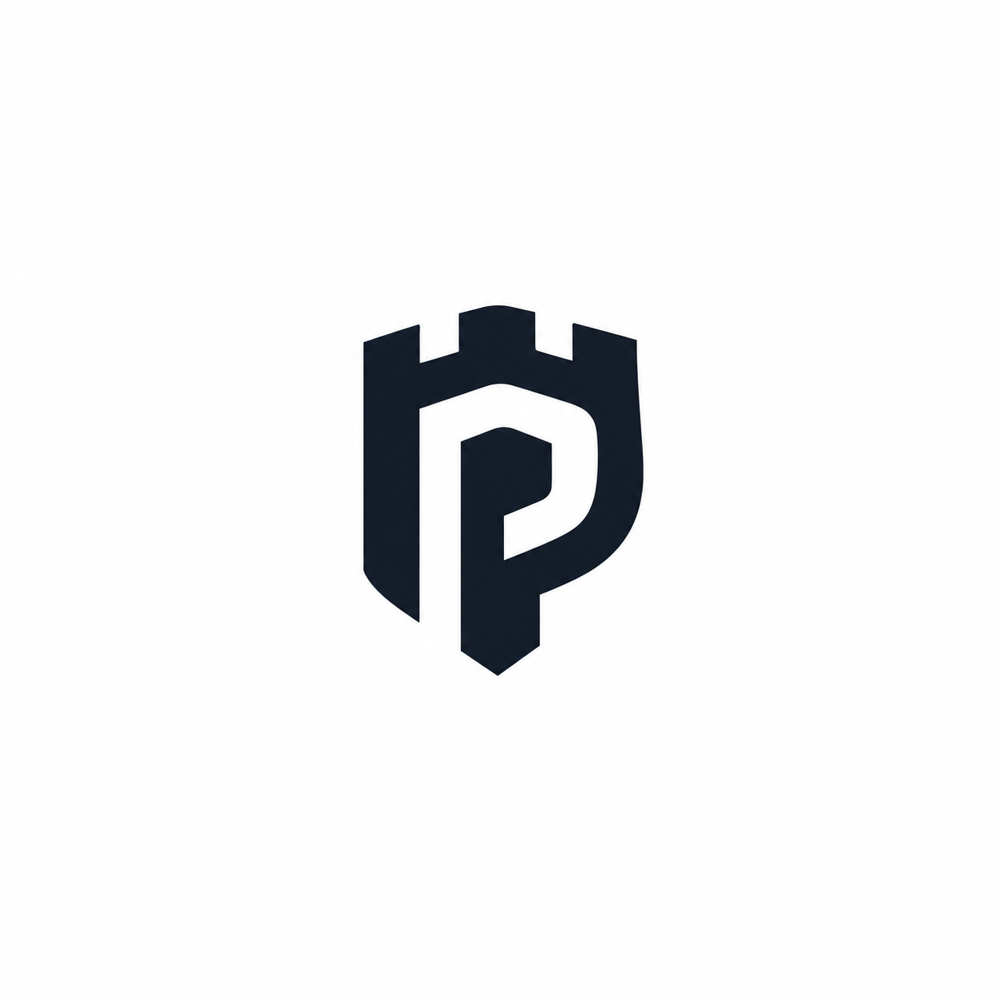

  

<h1 align="center">PenFortress</h1>

  <b>Your findings. Your server. Your control.</b> 
  Open-source, self-hosted penetration test management.

---

## Why PenFortress?

Penetration testing data is some of the most sensitive information a company
holds. Yet most teams still manage it across spreadsheets, chat, email and
shared folders, or hand it to **third-party SaaS** platforms.

**PenFortress brings the entire engagement lifecycle into one platform that
runs on your own infrastructure.** No external cloud dependency, no vendor
holding your vulnerability data, and no scattered findings.

## What makes it different

### Data sovereignty by design
Runs entirely on your own server with Docker. Apart from optional email
delivery, nothing depends on an external service, and it works fully offline.

### Zero-trust access control
Every request is authorised on the server against both the user's role and
their project assignment. Custom roles can be built from granular permissions,
and clients are strictly isolated from each other and from internal data.

### Quality-controlled findings
Findings go through a structured review and retest lifecycle, so what reaches
the client has been verified by a senior tester, not just reported.

### Tamper-resistant audit trail
Every action is recorded in an append-only history with user, role, and timestamp. 
Records are written in the same transaction as the action,
so nothing happens without leaving a trace.

### Security-first foundation
Mandatory MFA for staff, strong password hashing, encryption at rest for the
database, evidence and backups, malware scanning on uploads, and protection
against the OWASP Top 10.

### Professional, automated reporting
Generate branded, client-ready DOCX and PDF reports directly from verified
findings, with CVSS v3.1 scoring, evidence and remediation guidance.
Reports are versioned and published to clients only when you approve them.

## Built for every role on an engagement

| Role | What they get |
|------|---------------|
| **Administrators** | Full oversight of projects, teams and users without touching findings |
| **Senior pentesters** | Review, retest, close findings and publish reports |
| **Junior pentesters** | A guided workflow to record findings and evidence |
| **Developers** | A clean, focused list of verified issues to fix |
| **Clients** | A secure portal for verified findings and final reports |
<!--
## Repositories

| Repository | Description |
|------------|-------------|
| [**pen-fortress**]([MAIN_REPO_LINK]) | The core platform |
 | [**docs**]([DOCS_LINK]) | Installation, administration and user guides | -->

## Project status

PenFortress is **under active development**. Follow the main repository to
track progress, and star it if you'd like to see it succeed.
<!--
## Contributing

Contributions, ideas and security research are welcome.
Please read our [Contributing Guide]([LINK]) and
[Security Policy]([LINK]) before getting started.

To report a vulnerability in PenFortress itself, please **do not** open a
public issue. Follow the process in our Security Policy. -->

---

  Built by Muhammad Husnain, Muhammad Sami and Adrees Cheema · Licensed under AGPL-3.0

